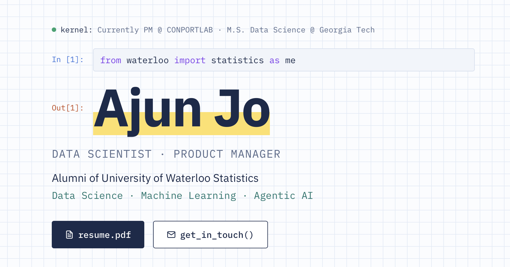

# Snapshots.Me

My personal website, designed like a Jupyter notebook. It covers my projects, tech stack, and career timeline.

**Live: [snapshotsme.netlify.app](https://snapshotsme.netlify.app/)**

- Day and night themes that switch with the visitor's local time
- Works on phones, tablets, and desktops

Built with React, Vite, Tailwind CSS, and Framer Motion. Hosted on Netlify.
